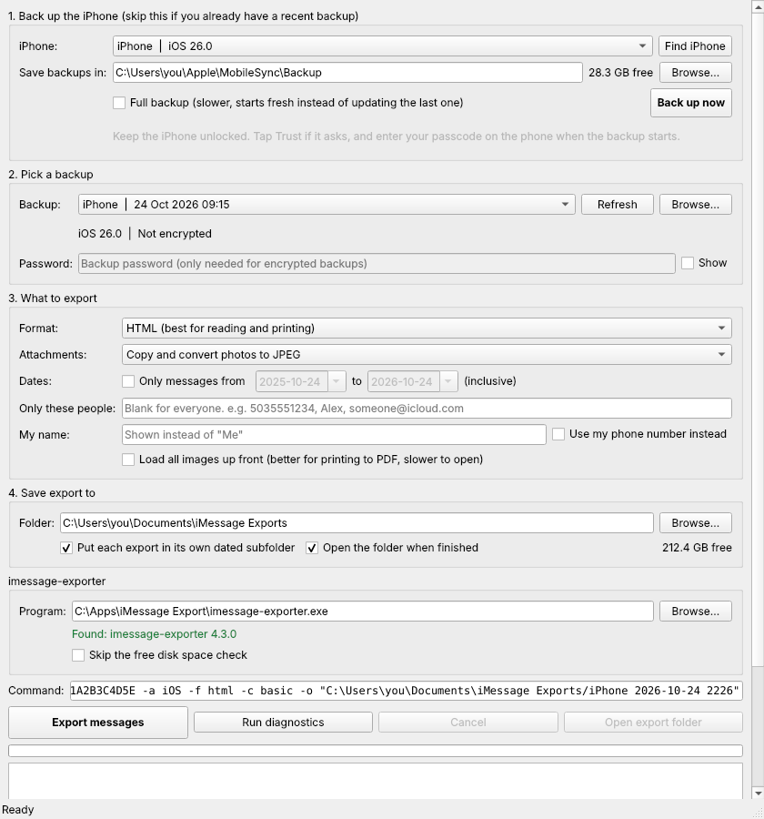

<p align="center"></p>

# iMessage Export

A simple Windows app that backs up an iPhone to your PC and saves its iMessages and texts as web pages or text files you can read, search and print. No command line needed.

It's a point-and-click front end for **[imessage-exporter](https://github.com/ReagentX/imessage-exporter)** by **Christopher Sardegna ([@ReagentX](https://github.com/ReagentX))**, which does the actual reading and exporting of messages. All credit for the export engine goes to that project. This app adds the window, finds your backups, and can make the iPhone backup for you.

## Download and run

1. Go to the **[latest release](https://github.com/Kungpow1989/imessage-export-gui/releases/latest)** and download **iMessage-Export-Windows-x64.zip**.
2. Unzip it anywhere (Documents is fine). Keep everything in the `iMessage Export` folder together.
3. Double-click **iMessage Export.exe**.
4. If Windows shows **"Windows protected your PC"**, click **More info**, then **Run anyway**. This appears because the app isn't code-signed.

You'll also need the free **[Apple Devices](https://apps.microsoft.com/detail/9NP83LWLPZ9K)** app from the Microsoft Store (or iTunes). You don't have to open it; it just installs the USB driver that lets Windows talk to the iPhone.

Nothing else to install. Python, the backup tool and imessage-exporter are all included.

## Using it

1. **Back up the iPhone.** Plug it in with a cable, unlock it, and tap **Trust** if asked. Click **Find iPhone**, then **Back up now**, and enter your passcode on the phone when it asks. The first backup can take a while; later ones only copy what changed. Skip this if you already have a recent backup from Apple Devices or iTunes.
2. **Pick a backup.** A new backup is picked for you. If you turned on "Encrypt local backup", type that password.
3. **Choose what to export.** HTML or plain text, how to handle photos and attachments, an optional date range, and optionally only certain people (by name, number or email).
4. **Choose where to save** and click **Export messages**. The folder opens when it's done.

### Good to know

- **It needs a backup on this PC.** iCloud backups can't be read. Encrypting the backup is optional.
- **Some older photos may be missing** if Messages in iCloud is on with "Optimise Storage", since those only live in iCloud. The message text is still there.
- **A conversation can be split across files.** If someone switched between iMessage and SMS, or messaged from their email address, their messages may be in more than one export file.
- **Converting attachments (optional):** to turn HEIC photos into JPEG and convert audio and video, install ImageMagick and ffmpeg:
  ```
  winget install ImageMagick.ImageMagick Gyan.FFmpeg
  ```
- Your backup password is passed to imessage-exporter on its command line, because its password prompt can't be answered from a window. Other programs on the same PC could briefly see it. That's normally fine on your own computer.

## Running from source

If you'd rather run the Python script directly:

1. Download or clone this repo.
2. Double-click **setup.bat**. It installs Python (if needed), PySide6, pymobiledevice3, the latest imessage-exporter, optionally ImageMagick and ffmpeg, checks for the Apple USB driver, and makes a desktop shortcut.

`setup.bat` is only a launcher that runs `setup.ps1` without changing your PowerShell security settings, so keep the two together.

## Building the exe

Releases are built automatically by GitHub Actions on Windows (see `.github/workflows/release.yml`). Every push to `main` builds the app, bundles the latest imessage-exporter, and runs a self test. To publish a new version, bump `APP_VERSION` in `imessage_export_gui.py` (for example to `1.0.1`) and push: the build creates release `v1.0.1` with the zip attached.

To build locally on Windows with Python 3.13:

```
powershell -ExecutionPolicy Bypass -File build.ps1
```

The result is in `dist\`.

## Credits

- **[imessage-exporter](https://github.com/ReagentX/imessage-exporter)** by Christopher Sardegna (ReagentX) and contributors. Exports the messages. GPL-3.0. The release includes its unmodified Windows build.
- **[pymobiledevice3](https://github.com/doronz88/pymobiledevice3)** by doronz88, matan1008 and contributors. Makes the iPhone backup over USB. GPL-3.0-or-later.
- **[PySide6](https://doc.qt.io/qtforpython/)** (Qt for Python) by The Qt Company. The user interface. LGPL-3.0.

See [THIRD-PARTY-NOTICES.md](THIRD-PARTY-NOTICES.md) for details.

## License

GNU General Public License v3.0. See [LICENSE](LICENSE).

This project isn't affiliated with or endorsed by Apple. iPhone and iMessage are trademarks of Apple Inc.
